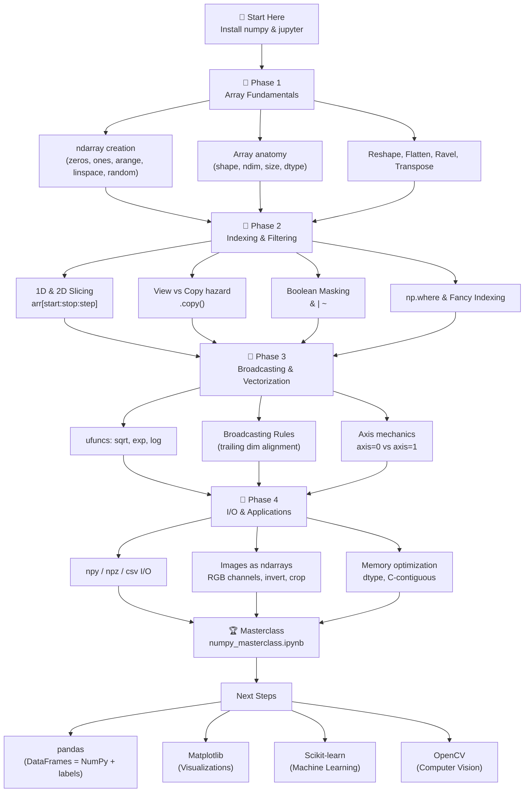

<div align="center">

# 🧮 NumPy: Zero to Hero — Interactive Learning Guide


**The most complete NumPy reference for beginners and intermediate developers.**  
*Read this README alone — and you'll learn NumPy.*

[](https://www.python.org/)
[](https://numpy.org/)
[](https://jupyter.org/)
[](https://opensource.org/licenses/MIT)
[]()

</div>

---

## 📋 Table of Contents

| # | Topic | Level |
|---|-------|-------|
| 1 | [🤔 What is NumPy & Why Use It?](#-what-is-numpy--why-use-it) | Beginner |
| 2 | [⚡ Quick Start & Installation](#-quick-start--installation) | Beginner |
| 3 | [🗂️ Repository Structure](#️-repository-structure) | Beginner |
| 4 | [📐 Phase 1 — Array Fundamentals](#-phase-1--array-fundamentals) | Beginner |
| 5 | [🔪 Phase 2 — Indexing, Slicing & Filtering](#-phase-2--indexing-slicing--filtering) | Beginner |
| 6 | [📡 Phase 3 — Broadcasting & Vectorization](#-phase-3--broadcasting--vectorization) | Intermediate |
| 7 | [💾 Phase 4 — File I/O & Image Processing](#-phase-4--file-io--image-processing) | Intermediate |
| 8 | [📊 Statistics & Aggregations Reference](#-statistics--aggregations-reference) | Intermediate |
| 9 | [🧮 Linear Algebra Reference](#-linear-algebra-reference) | Intermediate |
| 10 | [⚠️ Common Pitfalls & Gotchas](#️-common-pitfalls--gotchas) | All levels |
| 11 | [🗒️ NumPy Cheat Sheet](#️-numpy-cheat-sheet) | Reference |
| 12 | [🗺️ NumPy Learning Roadmap](#️-numpy-learning-roadmap) | Guide |
| 13 | [🧩 Practice Challenges](#-practice-challenges) | All levels |

---

## 🤔 What is NumPy & Why Use It?

**NumPy** (*Numerical Python*) is the foundational package for scientific computing in Python. It introduces the `ndarray` — an N-dimensional array object — that makes numerical operations **fast, concise, and memory-efficient**.

### Why Not Just Use Python Lists?

```python
# Python lists — slow and verbose
py_list  = [1, 2, 3, 4, 5]
doubled  = [x * 2 for x in py_list]   # Loop required!

# NumPy arrays — fast and mathematical
import numpy as np
np_array = np.array([1, 2, 3, 4, 5])
doubled  = np_array * 2                # Element-wise, no loop needed!
```

### Speed Comparison

```
Python list (1,000,000 elements) × 2:   ~65 ms
NumPy array (1,000,000 elements) × 2:   ~1.3 ms
                                       ─────────
                              NumPy is  ~50x FASTER
```

### Who Uses NumPy?

> Every major Python data/AI library is built **on top of** NumPy:

```
Your Code
    │
    ▼
pandas ──► DataFrames built on ndarrays
Matplotlib ──► Plots rendered from ndarrays
Scikit-learn ──► ML models train on ndarrays
TensorFlow / PyTorch ──► Tensors are GPU ndarrays
OpenCV ──► Images loaded as ndarrays
```

---

## ⚡ Quick Start & Installation

### Step 1 — Clone the repository

```bash
git clone https://github.com/Cy-nape/NumPy-guide.git
cd NumPy-guide
```

### Step 2 — Create a virtual environment

<details>
<summary><kbd>🍎 macOS / Linux</kbd></summary>

```bash
python3 -m venv venv
source venv/bin/activate
pip install -r requirements.txt
```

</details>

<details>
<summary><kbd>🪟 Windows (PowerShell)</kbd></summary>

```powershell
python -m venv venv
venv\Scripts\Activate.ps1
pip install -r requirements.txt
```

</details>

<details>
<summary><kbd>🐍 Using Conda/Mamba</kbd></summary>

```bash
conda create -n numpy-guide python=3.11
conda activate numpy-guide
conda install numpy matplotlib jupyter ipykernel
```

</details>

### Step 3 — Launch Jupyter

```bash
jupyter notebook
```

Then open any `phase-*.ipynb` notebook, or open `numpy_masterclass.ipynb` for the full combined workbook.

### Step 4 — Verify installation

```python
import numpy as np
print(np.__version__)       # e.g. 2.5.2
print(np.array([1,2,3]))    # [1 2 3]
```

---

## 🗂️ Repository Structure

```text
NumPy-guide/
│
├── 📄 README.md                  ← You are here — the interactive learning guide
├── 📄 requirements.txt           ← numpy, matplotlib, jupyter, ipykernel
├── 📄 LICENSE                    ← MIT License
├── 📄 .gitignore                 ← Excludes venv/, .ipynb_checkpoints/, *.npy
│
├── 📓 phase-1.ipynb              ← Fundamentals, Array Creation, Reshaping
├── 📓 phase-2.ipynb              ← Indexing, Slicing, Boolean Masking, Stacking
├── 📓 phase-3.ipynb              ← Broadcasting, Vectorization, Analytics Case Study
├── 📓 phase-4.ipynb              ← File I/O, Image Processing, Memory Optimization
├── 📓 numpy_masterclass.ipynb    ← All-in-one combined workbook
│
└── 📁 docs/
    ├── 📄 installation.md        ← Detailed setup for macOS, Windows, Linux
    ├── 📄 cheat_sheet.md         ← Quick syntax reference card
    └── 📄 faq.md                 ← Pitfalls, View vs Copy, Axis confusion
```

---

## 📐 Phase 1 — Array Fundamentals

> 📓 **Notebook:** [`phase-1.ipynb`](phase-1.ipynb)

### 1.1 — The `ndarray` Object

The core building block of NumPy is the **`ndarray`** (N-Dimensional Array).

```
Dimension     Name        Shape Example     Real-world example
─────────     ────        ─────────────     ──────────────────
  0-D         Scalar      ()                Temperature: 36.5
  1-D         Vector      (5,)              [10, 20, 30, 40, 50]
  2-D         Matrix      (3, 4)            Spreadsheet / Image (grayscale)
  3-D         Tensor      (3, 224, 224)     Color image (RGB channels)
  4-D         Tensor      (8, 3, 224, 224)  Batch of 8 color images
```

### 1.2 — Creating Arrays

<details>
<summary><b>📌 From Python lists</b></summary>

```python
import numpy as np

# 1D — Vector
v = np.array([1, 2, 3, 4, 5])

# 2D — Matrix (must be a list of equal-length lists)
M = np.array([
    [1, 2, 3],
    [4, 5, 6]
])

# 3D — Tensor (a stack of matrices)
T = np.array([
    [[1, 2], [3, 4]],
    [[5, 6], [7, 8]]
])

print(f"v shape: {v.shape}")   # (5,)
print(f"M shape: {M.shape}")   # (2, 3)
print(f"T shape: {T.shape}")   # (2, 2, 2)
```

</details>

<details>
<summary><b>🏭 Built-in generator functions</b></summary>

| Function | What it creates | Example |
|----------|-----------------|---------|
| `np.zeros((r, c))` | All zeros (float64) | `[[0., 0.], [0., 0.]]` |
| `np.ones((r, c))` | All ones (float64) | `[[1., 1.], [1., 1.]]` |
| `np.full((r, c), v)` | Filled with value `v` | `[[7, 7], [7, 7]]` |
| `np.eye(n)` | Identity matrix | `[[1,0,0],[0,1,0],[0,0,1]]` |
| `np.empty((r, c))` | Uninitialized memory | (garbage values — fastest) |
| `np.arange(start, stop, step)` | Range sequence | `[0, 2, 4, 6, 8]` |
| `np.linspace(start, stop, n)` | `n` evenly spaced pts | `[0., 0.25, 0.5, 0.75, 1.]` |
| `np.random.rand(r, c)` | Uniform random [0, 1) | `[[0.42, 0.72], ...]` |
| `np.random.randn(r, c)` | Standard Normal (μ=0, σ=1) | `[[-0.2, 1.3], ...]` |
| `np.random.randint(lo, hi, size)` | Random integers | `[[12, 87, 45], ...]` |

```python
np.random.seed(42)   # Always set seed for reproducibility!

zeros    = np.zeros((3, 4))
ones     = np.ones((2, 3))
filled   = np.full((2, 2), 7)
identity = np.eye(3)
sequence = np.arange(0, 10, 2)        # [0, 2, 4, 6, 8]
evenly   = np.linspace(0, 1, 5)       # [0., 0.25, 0.5, 0.75, 1.]
rand_int = np.random.randint(1, 100, size=(3, 3))
```

</details>

### 1.3 — Inspecting Array Anatomy

Every `ndarray` carries metadata you should always know:

```python
arr = np.array([[1.5, 2.5, 3.5], [4.5, 5.5, 6.5]])

arr.shape      # (2, 3)  → (rows, columns)
arr.ndim       # 2       → number of dimensions
arr.size       # 6       → total number of elements
arr.dtype      # float64 → data type of every element
arr.itemsize   # 8       → bytes each element takes
arr.nbytes     # 48      → total memory = size × itemsize
```

### 1.4 — Memory & Data Types

Choosing the right `dtype` can **cut memory usage by 4–8×**:

| dtype | Storage | Range / Precision |
|-------|---------|-------------------|
| `bool` | 1 byte | True / False |
| `int8` | 1 byte | -128 to 127 |
| `int32` | 4 bytes | -2.1B to 2.1B |
| `int64` | 8 bytes | default Python int |
| `float16` | 2 bytes | ±65504 (ML inference) |
| `float32` | 4 bytes | ±3.4×10³⁸ (ML training) |
| `float64` | 8 bytes | default Python float |
| `complex64` | 8 bytes | complex numbers |

```python
# Cast between types with .astype()
arr_f64 = np.array([1.9, 2.7, 3.1])          # float64 by default
arr_i32 = arr_f64.astype(np.int32)            # [1, 2, 3] — truncates decimals

# Explicit dtype at creation
arr_f32 = np.ones((1000, 1000), dtype=np.float32)
print(f"Memory: {arr_f32.nbytes / 1e6:.1f} MB")   # 4.0 MB instead of 8.0 MB
```

### 1.5 — Reshaping Arrays

```python
arr = np.arange(24)         # shape: (24,)

# Reshape into 3D tensor (2 blocks, 3 rows, 4 cols)
tensor  = arr.reshape(2, 3, 4)    # shape: (2, 3, 4)

# -1 means "calculate this dimension automatically"
matrix  = arr.reshape(4, -1)      # NumPy calculates: 24/4 = 6  → shape (4, 6)
matrix2 = arr.reshape(-1, 8)      # NumPy calculates: 24/8 = 3  → shape (3, 8)
```

**Visual of reshape:**

```
np.arange(12):
[ 0  1  2  3  4  5  6  7  8  9 10 11 ]
shape: (12,)

After .reshape(3, 4):
[[ 0  1  2  3 ]
 [ 4  5  6  7 ]
 [ 8  9 10 11 ]]
shape: (3, 4)

After .T (transpose — swap rows ↔ cols):
[[ 0  4  8 ]
 [ 1  5  9 ]
 [ 2  6 10 ]
 [ 3  7 11 ]]
shape: (4, 3)
```

### 1.6 — `.flatten()` vs `.ravel()` — Copy vs View

```python
M = np.array([[1, 2, 3], [4, 5, 6]])

# flatten() — always creates a NEW independent copy
flat_copy = M.flatten()
flat_copy[0] = 999
print(M[0, 0])          # 1 → Original unchanged ✅

# ravel() — returns a VIEW (same memory) if possible
flat_view = M.ravel()
flat_view[0] = 999
print(M[0, 0])          # 999 → Original CHANGED! ⚠️
```

> **Rule of thumb:** Use `.ravel()` for performance; use `.flatten()` when you explicitly need a safe, independent copy.

---

## 🔪 Phase 2 — Indexing, Slicing & Filtering

> 📓 **Notebook:** [`phase-2.ipynb`](phase-2.ipynb)

### 2.1 — 1D Indexing & Slicing

```python
arr = np.array([10, 20, 30, 40, 50, 60, 70, 80])
#index:          0   1   2   3   4   5   6   7
#neg index:     -8  -7  -6  -5  -4  -3  -2  -1

arr[0]           # 10   → first element
arr[-1]          # 80   → last element
arr[2:6]         # [30, 40, 50, 60]   → slice [start:stop) exclusive stop
arr[1:7:2]       # [20, 40, 60]       → every 2nd element
arr[::-1]        # [80, 70, 60, 50, 40, 30, 20, 10]  → reversed
arr[:4]          # [10, 20, 30, 40]   → first 4
arr[-3:]         # [60, 70, 80]       → last 3
```

### 2.2 — 2D Indexing

```python
M = np.array([
    [ 1,  2,  3,  4],   # row 0
    [ 5,  6,  7,  8],   # row 1
    [ 9, 10, 11, 12]    # row 2
])

M[1, 2]          # 7      → single element (row 1, col 2)
M[0]             # [1, 2, 3, 4]       → entire row 0
M[:, 1]          # [2, 6, 10]         → entire column 1
M[0:2, 1:3]      # [[2,3],[6,7]]      → submatrix block
M[-1, :]         # [9, 10, 11, 12]    → last row
M[:, -1]         # [4, 8, 12]         → last column
M[::2, ::2]      # [[1,3],[9,11]]     → every 2nd row AND col
```

### 2.3 — ⚠️ The View vs Copy Trap (Critical!)

This is the **most common mistake** NumPy beginners make:

```
┌─────────────────────────────────────────────────────────────┐
│                     MEMORY BUFFER                           │
│  [ 10 | 20 | 30 | 40 | 50 ]                               │
│    ↑              ↑                                         │
│  original       slice_view ← SAME MEMORY BLOCK             │
└─────────────────────────────────────────────────────────────┘
```

```python
original   = np.array([10, 20, 30, 40, 50])
slice_view = original[1:4]       # View — same memory!

slice_view[0] = 9999
print(original)    # [10, 9999, 30, 40, 50]  ← Mutated! 😱

# ✅ Safe approach: explicitly call .copy()
safe_copy  = original[1:4].copy()
safe_copy[0] = 7777
print(original)    # Still unchanged ✅
```

**Quick reference — when do you get a View vs Copy?**

| Operation | Returns |
|-----------|---------|
| `arr[2:5]` basic slice | **View** ⚠️ |
| `arr[::2]` strided slice | **View** ⚠️ |
| `arr[[0, 2, 4]]` list of indices | **Copy** ✅ |
| `arr[arr > 5]` boolean mask | **Copy** ✅ |
| `arr.reshape(...)` | **View** (usually) ⚠️ |
| `arr.flatten()` | **Copy** ✅ |
| `arr.ravel()` | **View** (usually) ⚠️ |
| `arr.copy()` | **Copy** ✅ |

### 2.4 — Sorting & Ranking

```python
scores = np.array([72, 45, 91, 55, 88, 63])

# Sort (returns new sorted array)
np.sort(scores)             # [45, 55, 63, 72, 88, 91]

# argsort — returns INDICES that would sort the array
indices = np.argsort(scores)   # [1, 3, 5, 0, 4, 2]
# i.e. element at index 1 is smallest, index 2 is largest

# Rank top 3 by sorting descending:
top3 = scores[np.argsort(scores)[::-1][:3]]   # [91, 88, 72]

# 2D sorting across axes:
M = np.array([[3, 1], [2, 9], [5, 0]])
np.sort(M, axis=0)  # Sort each COLUMN independently (compare rows)
np.sort(M, axis=1)  # Sort each ROW independently (compare cols)
```

### 2.5 — Boolean Masking

Boolean masks are the NumPy equivalent of SQL `WHERE` clauses:

```python
prices = np.array([12, 55, 83, 42, 97, 23, 60])

# Step 1: Create the boolean mask
mask = prices > 50
# [False, True, True, False, True, False, True]

# Step 2: Apply mask to filter
expensive = prices[mask]
# [55, 83, 97, 60]

# --- Combining conditions ---
# AND: use &   (not 'and')
mid_range = prices[(prices >= 30) & (prices <= 70)]   # [55, 42, 60]

# OR: use |   (not 'or')
extremes  = prices[(prices < 20) | (prices > 80)]    # [12, 83, 97]

# NOT: use ~   (not 'not')
not_cheap = prices[~(prices < 30)]                   # [55, 83, 42, 97, 60]
```

### 2.6 — Fancy Indexing & `np.where()`

```python
data = np.array([10, 25, 40, 55, 70, 85])

# Fancy indexing: use a list of arbitrary indices
print(data[[0, 2, 5]])    # [10, 40, 85]

# np.where(condition) → returns tuple of index arrays
where_result = np.where(data > 50)
print(where_result)        # (array([3, 4, 5]),)
print(data[where_result])  # [55, 70, 85]

# np.where(condition, val_if_true, val_if_false) → vectorized ternary
labels = np.where(data >= 50, "PASS", "FAIL")
# ['FAIL', 'FAIL', 'FAIL', 'PASS', 'PASS', 'PASS']
```

### 2.7 — Joining & Stacking Arrays

```python
a = np.array([[1, 2, 3]])   # shape (1, 3)
b = np.array([[4, 5, 6]])   # shape (1, 3)

np.vstack((a, b))   # Vertical stack → adds rows   → shape (2, 3)
# [[1, 2, 3],
#  [4, 5, 6]]

np.hstack((a, b))   # Horizontal stack → adds cols → shape (1, 6)
# [[1, 2, 3, 4, 5, 6]]

# concatenate is the most flexible:
np.concatenate((a, b), axis=0)   # Same as vstack
np.concatenate((a, b), axis=1)   # Same as hstack

# Delete elements:
np.delete(a, 1, axis=1)   # Delete column index 1
# [[1, 3]]
```

---

## 📡 Phase 3 — Broadcasting & Vectorization

> 📓 **Notebook:** [`phase-3.ipynb`](phase-3.ipynb)

### 3.1 — Vectorization (No More Loops!)

A **ufunc** (Universal Function) applies element-wise operations using fast compiled C routines:

```python
arr = np.array([1.0, 4.0, 9.0, 16.0, 25.0])

# Math ufuncs:
np.sqrt(arr)   # [1., 2., 3., 4., 5.]
np.log(arr)    # Natural log of each element
np.exp(arr)    # e^x for each element
np.sin(arr)    # Sine of each element (in radians)
np.abs(arr)    # Absolute value

# Arithmetic between two arrays is also vectorized:
x = np.array([1, 2, 3])
y = np.array([10, 20, 30])
x + y     # [11, 22, 33]
x * y     # [10, 40, 90]
x ** 2    # [1, 4, 9]
```

### 3.2 — Broadcasting — The Golden Rules

Broadcasting is how NumPy handles arithmetic between arrays of **different shapes**. It automatically "stretches" dimensions without copying data.

**Two shapes are compatible if, comparing from the right:**
1. They are **equal**, OR
2. One of them is **1**

```
Example:
  Shape A:  (3, 4)
  Shape B:     (4,)   → treated as (1, 4)
              ─────
  Stretch B:  (3, 4)   → B is tiled down 3 rows
  Result:     (3, 4) ✅

Another Example:
  Shape A:  (3, 1)
  Shape B:  (1, 4)
  Stretch:  (3, 4) ✅  → Grid of all combinations!
```

**Live examples:**

```python
M = np.array([[1, 2, 3], [4, 5, 6]])      # shape (2, 3)
s = 10                                     # scalar → treated as (1,) → (1,1) → (2,3)
r = np.array([10, 20, 30])                 # shape (3,) → (1,3) → (2,3)
c = np.array([[100], [200]])               # shape (2,1) → (2,3)

M + s    # [[11,12,13],[14,15,16]]  — scalar broadcast
M + r    # [[11,22,33],[14,25,36]]  — row vector broadcast
M + c    # [[101,102,103],[204,205,206]]  — column broadcast

# Fixing a broadcast mismatch with np.newaxis:
v = np.array([1, 2, 3])         # shape (3,) — matches 3 COLUMNS
# To broadcast across 3 ROWS instead:
v[:, np.newaxis]                 # shape (3, 1) — now stretches across columns
```

### 3.3 — Axis Mechanics Deep Dive

**Mental model: `axis` is the dimension that gets COLLAPSED:**

```
Matrix M (2 rows, 3 cols):
       col0  col1  col2
row0: [  10,   20,   30 ]
row1: [  40,   50,   60 ]

np.sum(M, axis=0)   → Collapse rows   → [50, 70, 90]   shape: (3,)
                       (sum DOWN each column)

np.sum(M, axis=1)   → Collapse cols   → [60, 150]       shape: (2,)
                       (sum ACROSS each row)

np.sum(M)           → Collapse ALL    → 210              shape: ()
```

```python
M = np.array([[10, 20, 30], [40, 50, 60]])

np.sum(M, axis=0)    # [50, 70, 90]   — column totals
np.sum(M, axis=1)    # [60, 150]      — row totals
np.mean(M, axis=0)   # [25., 35., 45.] — column averages
np.mean(M, axis=1)   # [20., 50.]     — row averages
np.max(M, axis=0)    # [40, 50, 60]   — column maximums
np.argmax(M, axis=1) # [2, 2]         — index of max in each row
```

### 3.4 — Z-Score Normalization (Real-World Example)

A fundamental preprocessing step in machine learning:

```python
X = np.random.randint(10, 100, size=(5, 3)).astype(float)

# Compute column-wise statistics (each column is a feature)
mean = np.mean(X, axis=0)   # shape (3,)  — mean of each feature
std  = np.std(X, axis=0)    # shape (3,)  — std  of each feature

# Normalize — broadcasting handles (5,3) - (3,) automatically
X_normalized = (X - mean) / std

# Verify: each column now has mean≈0 and std≈1
print(np.round(np.mean(X_normalized, axis=0), 5))  # [~0, ~0, ~0]
print(np.round(np.std(X_normalized, axis=0), 5))   # [~1, ~1, ~1]
```

---

## 💾 Phase 4 — File I/O & Image Processing

> 📓 **Notebook:** [`phase-4.ipynb`](phase-4.ipynb)

### 4.1 — Saving & Loading Arrays

```python
arr = np.array([[1, 2, 3], [4, 5, 6]])

# Binary format (.npy) — fast, lossless, preserves dtype
np.save("my_array.npy", arr)
loaded = np.load("my_array.npy")

# Multiple arrays compressed into one file (.npz)
np.savez_compressed("archive.npz", train=arr, labels=np.array([0, 1, 2]))
data        = np.load("archive.npz")
train_data  = data["train"]
label_data  = data["labels"]

# CSV / text — interoperable with Excel, pandas, etc.
np.savetxt("data.csv", arr, delimiter=",", fmt="%.2f", header="a,b,c", comments="")
loaded_csv  = np.loadtxt("data.csv", delimiter=",", skiprows=1)
```

**When to use each format:**

| Format | Speed | File size | Interoperability |
|--------|-------|-----------|-----------------|
| `.npy` | ⚡⚡⚡ Fast | Small | NumPy only |
| `.npz` | ⚡⚡⚡ Fast | Smallest | NumPy only |
| `.csv` | 🐢 Slow | Largest | Universal ✅ |

### 4.2 — Images as NumPy Arrays

Every digital image is an `ndarray`:

```
Grayscale image (100 × 100):   ndarray shape (100, 100)        dtype: uint8 [0–255]
Color RGB image (100 × 100):   ndarray shape (100, 100, 3)     dtype: uint8 [0–255 per channel]
                                                     ┌─────────────────┐
                                                     │ 0=Red  channel  │
                                                     │ 1=Green channel │
                                                     │ 2=Blue  channel │
                                                     └─────────────────┘
```

```python
# Grayscale image operations
gray = np.random.randint(0, 256, (100, 100), dtype=np.uint8)

# Invert image (photographic negative)
inverted = 255 - gray

# Crop region of interest (top-left 50×50 block)
roi = gray[:50, :50]

# Threshold: create a binary mask
binary = np.where(gray > 128, 255, 0).astype(np.uint8)

# Flip horizontally
flipped_h = gray[:, ::-1]

# Flip vertically
flipped_v = gray[::-1, :]

# Rotate 90° clockwise = Transpose then flip horizontally
rotated_90 = gray.T[:, ::-1]
```

```python
# RGB color image operations
rgb = np.random.randint(0, 256, (100, 100, 3), dtype=np.uint8)

# Isolate individual channels
red_channel   = rgb[:, :, 0]   # shape (100, 100)
green_channel = rgb[:, :, 1]
blue_channel  = rgb[:, :, 2]

# Dark mode inversion (normalized float values)
rgb_float = rgb / 255.0        # Normalize to [0, 1]
inverted  = 1.0 - rgb_float    # Invert
```

---

## 📊 Statistics & Aggregations Reference

```python
data = np.array([[2, 4, 6], [1, 5, 9], [3, 3, 3]])

# Central tendency
np.mean(data)                # Arithmetic mean of all elements
np.median(data)              # Middle value
np.average(data, weights=…)  # Weighted average

# Spread
np.std(data)                 # Standard deviation
np.var(data)                 # Variance (= std²)
np.ptp(data)                 # Peak-to-peak = max - min

# Min / Max
np.min(data),  np.max(data)
np.argmin(data), np.argmax(data)   # Flat index of min/max
np.amin(data, axis=0)              # Column minimums

# Rounding
np.round(data, decimals=2)
np.floor(data),  np.ceil(data)

# Cumulative
np.cumsum(data)              # Running total (flattened)
np.cumprod(data)             # Running product
np.diff(data, axis=1)        # Differences between adjacent elements

# Sorting
np.sort(data)                # Sorted copy
np.argsort(data)             # Indices that would sort the array
np.unique(data)              # Unique values (sorted)
np.unique(data, return_counts=True)  # Unique + their occurrence counts

# NaN-safe versions (ignore missing values)
np.nanmean(data)             # Mean ignoring NaN
np.nansum(data)              # Sum ignoring NaN
np.nanmax(data)              # Max ignoring NaN
np.isnan(data)               # Boolean mask: True where NaN
data_clean = np.nan_to_num(data, nan=0.0)  # Replace NaN with 0
```

---

## 🧮 Linear Algebra Reference

```python
u = np.array([1, 2, 3])
v = np.array([4, 5, 6])
A = np.array([[1, 2], [3, 4]])
B = np.array([[2, 0], [1, 2]])

# ── Vector operations ──────────────────────────────────────
np.dot(u, v)              # Dot product: 1×4 + 2×5 + 3×6 = 32
u @ v                     # Same as np.dot (Python 3.5+)
np.cross(u, v)            # Cross product (3D vectors only)
np.linalg.norm(u)         # Euclidean length ‖u‖ = √(1²+2²+3²) = 3.742
np.linalg.norm(u, ord=1)  # L1 norm (Manhattan) = |1|+|2|+|3| = 6
np.linalg.norm(u, ord=np.inf)  # L∞ norm = max(|1|,|2|,|3|) = 3

# Cosine similarity (used in NLP, recommendations)
cos_sim = np.dot(u, v) / (np.linalg.norm(u) * np.linalg.norm(v))

# ── Matrix operations ───────────────────────────────────────
A @ B                     # Matrix multiplication   (not A * B!)
A * B                     # Element-wise multiplication (Hadamard)
A.T                       # Transpose

np.linalg.inv(A)          # Matrix inverse A⁻¹
np.linalg.det(A)          # Determinant
np.linalg.eig(A)          # Eigenvalues & eigenvectors
np.linalg.svd(A)          # Singular Value Decomposition
np.linalg.solve(A, v)     # Solve linear system Ax = v
np.linalg.matrix_rank(A)  # Rank of matrix
np.trace(A)               # Trace = sum of diagonal elements
```

**Matrix multiplication step-by-step:**

```
A = [[1, 2],     B = [[2, 0],     A @ B = ?
     [3, 4]]          [1, 2]]

Result[0,0] = A[0,:] · B[:,0] = 1×2 + 2×1 = 4
Result[0,1] = A[0,:] · B[:,1] = 1×0 + 2×2 = 4
Result[1,0] = A[1,:] · B[:,0] = 3×2 + 4×1 = 10
Result[1,1] = A[1,:] · B[:,1] = 3×0 + 4×2 = 8

A @ B = [[4,  4],
         [10, 8]]
```

---

## ⚠️ Common Pitfalls & Gotchas

<details>
<summary><b>❌ Pitfall 1 — View vs Copy (the #1 mistake)</b></summary>

```python
# WRONG: Modifying a slice mutates the original!
original = np.array([1, 2, 3, 4, 5])
oops     = original[2:5]
oops[0]  = 999
print(original)   # [1, 2, 999, 4, 5]  — CHANGED! 😱

# RIGHT: Use .copy() for independence
safe     = original[2:5].copy()
safe[0]  = 777
print(original)   # Untouched ✅
```

</details>

<details>
<summary><b>❌ Pitfall 2 — Using `and`/`or` instead of `&`/`|`</b></summary>

```python
arr = np.array([1, 2, 3, 4, 5])

# WRONG: Python 'and' works on scalars, not arrays!
arr[arr > 1 and arr < 4]        # ValueError: ambiguous truth value

# RIGHT: Use bitwise operators with parentheses
arr[(arr > 1) & (arr < 4)]      # [2, 3] ✅
arr[(arr < 2) | (arr > 4)]      # [1, 5] ✅
```

</details>

<details>
<summary><b>❌ Pitfall 3 — Shape Mismatch in Broadcasting</b></summary>

```python
A = np.ones((3, 4))
b = np.array([1, 2, 3])   # shape (3,) — matches 3 ROWS? No! Aligns to COLUMNS

# This will FAIL because trailing dim 4 ≠ 3:
A + b    # ValueError: operands could not be broadcast together (3,4) and (3,)

# RIGHT: Reshape b to a column vector (3, 1)
A + b[:, np.newaxis]   # shape (3,1) broadcasts across 4 columns ✅
```

</details>

<details>
<summary><b>❌ Pitfall 4 — `*` is NOT matrix multiplication</b></summary>

```python
A = np.array([[1, 2], [3, 4]])
B = np.array([[2, 0], [1, 2]])

A * B    # Element-wise! [[2,0],[3,8]]  ← NOT what you usually want

A @ B    # Matrix multiplication (use this!) [[4,4],[10,8]] ✅
```

</details>

<details>
<summary><b>❌ Pitfall 5 — NaN contamination in aggregations</b></summary>

```python
data = np.array([10, np.nan, 20, 30])

np.mean(data)       # nan  ← NaN propagates! 😱
np.nanmean(data)    # 20.0 ← NaN-safe version ✅

np.sum(data)        # nan  ← Contaminated!
np.nansum(data)     # 60.0 ✅
```

</details>

<details>
<summary><b>❌ Pitfall 6 — Forgetting `axis` parameter</b></summary>

```python
M = np.array([[1, 2, 3], [4, 5, 6]])

np.sum(M)         # 21  ← Total sum, flattens everything
np.sum(M, axis=0) # [5, 7, 9]  ← Column sums (usually what you want)
np.sum(M, axis=1) # [6, 15]    ← Row sums
```

</details>

---

## 🗒️ NumPy Cheat Sheet

<details>
<summary><b>📌 Array Creation Quick Reference</b></summary>

```python
import numpy as np

np.array([1,2,3])               # From list
np.zeros((m, n))                # m×n of 0.0
np.ones((m, n))                 # m×n of 1.0
np.full((m, n), v)              # m×n of value v
np.eye(n)                       # n×n identity matrix
np.empty((m, n))                # m×n uninitialized
np.arange(start, stop, step)    # range sequence
np.linspace(start, stop, n)     # n evenly spaced points
np.random.seed(42)              # Set reproducibility seed
np.random.rand(m, n)            # Uniform [0, 1)
np.random.randn(m, n)           # Standard Normal (μ=0, σ=1)
np.random.randint(lo, hi, (m,n))# Random integers
np.random.choice(arr, n)        # Sample n values from arr
```

</details>

<details>
<summary><b>📌 Indexing & Slicing Quick Reference</b></summary>

```python
arr[i]           # 1D element at index i
arr[i, j]        # 2D element at row i, col j
arr[i:j]         # Elements from index i to j-1
arr[i:j:k]       # Every k-th element from i to j
arr[-1]          # Last element
arr[::-1]        # Reversed array
arr[:, j]        # Entire column j (2D)
arr[i, :]        # Entire row i (2D)
arr[mask]        # Elements where boolean mask is True
arr[[0,2,4]]     # Elements at specified indices (fancy indexing)
```

</details>

<details>
<summary><b>📌 Shape Manipulation Quick Reference</b></summary>

```python
arr.shape            # Tuple of dimensions e.g. (3, 4)
arr.ndim             # Number of dimensions
arr.size             # Total element count
arr.dtype            # Data type e.g. float64
arr.reshape(m, n)    # New shape (must have same total elements)
arr.reshape(-1)      # Flatten to 1D
arr.T                # Transpose (swap all axes)
arr.flatten()        # 1D copy
arr.ravel()          # 1D view (usually)
np.expand_dims(arr, axis=0)   # Add new axis
arr[:, np.newaxis]   # Add new axis (column vector)
np.squeeze(arr)      # Remove dimensions of size 1
```

</details>

<details>
<summary><b>📌 Math & Aggregation Quick Reference</b></summary>

```python
np.sum(arr, axis=n)      # Sum along axis n
np.mean(arr, axis=n)     # Mean along axis n
np.std(arr, axis=n)      # Standard deviation
np.min(arr, axis=n)      # Minimum
np.max(arr, axis=n)      # Maximum
np.argmin(arr, axis=n)   # Index of minimum
np.argmax(arr, axis=n)   # Index of maximum
np.cumsum(arr)           # Cumulative sum
np.sort(arr, axis=n)     # Sorted copy
np.argsort(arr, axis=n)  # Indices that sort the array
np.unique(arr)           # Unique values sorted
np.clip(arr, a_min, a_max) # Clamp values to range
np.where(cond, x, y)     # Ternary element selection
np.sqrt(arr)             # Square root
np.abs(arr)              # Absolute value
np.log(arr)              # Natural log
np.exp(arr)              # Exponential e^x
```

</details>

<details>
<summary><b>📌 File I/O Quick Reference</b></summary>

```python
np.save("file.npy", arr)              # Save single array
np.load("file.npy")                   # Load single array
np.savez_compressed("f.npz", a=arr1, b=arr2)  # Save multiple
data = np.load("f.npz"); data["a"]   # Load from archive
np.savetxt("f.csv", arr, delimiter=",") # Save to CSV
np.loadtxt("f.csv", delimiter=",")   # Load from CSV
```

</details>

---

## 🗺️ NumPy Learning Roadmap



---

## 🧩 Practice Challenges

Work through these challenges (solutions in the notebooks):

<details>
<summary><b>🟢 Beginner — Challenge 1: Border Matrix</b></summary>

Create an 8×8 matrix of zeros, then set all outer border cells to 1.

**Expected Output:**
```
[[1 1 1 1 1 1 1 1]
 [1 0 0 0 0 0 0 1]
 [1 0 0 0 0 0 0 1]
 [1 0 0 0 0 0 0 1]
 [1 0 0 0 0 0 0 1]
 [1 0 0 0 0 0 0 1]
 [1 0 0 0 0 0 0 1]
 [1 1 1 1 1 1 1 1]]
```

<details>
<summary>Show Solution</summary>

```python
M = np.zeros((8, 8), dtype=np.int32)
M[0, :] = 1    # Top row
M[-1, :] = 1   # Bottom row
M[:, 0] = 1    # Left column
M[:, -1] = 1   # Right column
```

</details>
</details>

<details>
<summary><b>🟢 Beginner — Challenge 2: FizzBuzz with NumPy</b></summary>

Given an array of integers 1–30, create a string array where:
- Multiples of 3 → `"Fizz"`
- Multiples of 5 → `"Buzz"`
- Multiples of both → `"FizzBuzz"`
- Otherwise → the number as a string

<details>
<summary>Show Solution</summary>

```python
nums   = np.arange(1, 31)
result = np.where(nums % 15 == 0, "FizzBuzz",
         np.where(nums % 3 == 0, "Fizz",
         np.where(nums % 5 == 0, "Buzz",
                  nums.astype(str))))
```

</details>
</details>

<details>
<summary><b>🟡 Intermediate — Challenge 3: Min-Max Normalization</b></summary>

Normalize each **column** of a matrix to range [0, 1]:  
`X_norm = (X - X_min) / (X_max - X_min)`

<details>
<summary>Show Solution</summary>

```python
np.random.seed(42)
X = np.random.randint(10, 100, size=(5, 3)).astype(float)

col_min = X.min(axis=0)   # shape (3,)
col_max = X.max(axis=0)   # shape (3,)

X_norm  = (X - col_min) / (col_max - col_min)
# Broadcasting: (5,3) - (3,) → (5,3) ✅
```

</details>
</details>

<details>
<summary><b>🟡 Intermediate — Challenge 4: Moving Average</b></summary>

Compute a **3-period rolling average** for a 1D time series without using any loop.

<details>
<summary>Show Solution</summary>

```python
series = np.array([10., 20., 30., 40., 50., 60., 70.])
window = 3

# Use np.convolve with a uniform kernel
kernel = np.ones(window) / window
moving_avg = np.convolve(series, kernel, mode='valid')
# [20., 30., 40., 50., 60.]
```

</details>
</details>

<details>
<summary><b>🔴 Advanced — Challenge 5: Pairwise Euclidean Distances</b></summary>

Given a matrix of N points (shape `(N, 2)`), compute the **N×N pairwise distance matrix** using broadcasting — no loops.

<details>
<summary>Show Solution</summary>

```python
points = np.array([[0, 0], [3, 0], [0, 4]])   # shape (3, 2)

# Expand dims to enable broadcasting:
# (3, 1, 2) - (1, 3, 2) → (3, 3, 2)
diff = points[:, np.newaxis, :] - points[np.newaxis, :, :]

# Compute distance: √(dx² + dy²)
dist_matrix = np.sqrt(np.sum(diff ** 2, axis=-1))

# Result:
# [[0.  3.  4.]
#  [3.  0.  5.]
#  [4.  5.  0.]]
```

</details>
</details>

---

## 📚 Notebooks at a Glance

| Notebook | Cells | Concepts | Has Plots |
|----------|-------|----------|-----------|
| [`phase-1.ipynb`](phase-1.ipynb) | 16 | Array creation, anatomy, reshape | ❌ |
| [`phase-2.ipynb`](phase-2.ipynb) | 18 | Indexing, masking, stacking | ❌ |
| [`phase-3.ipynb`](phase-3.ipynb) | 14 | Broadcasting, analytics, vectors | ✅ Matplotlib |
| [`phase-4.ipynb`](phase-4.ipynb) | 10 | File I/O, images as arrays | ✅ Image grids |
| [`numpy_masterclass.ipynb`](numpy_masterclass.ipynb) | 60+ | Everything combined | ✅ Full |

---

## 🤝 Contributing

Found a bug? Want to add a new challenge or case study?

1. Fork the repo
2. Create a branch: `git checkout -b feature/my-topic`
3. Add your content and run the notebook: `jupyter nbconvert --to notebook --execute`
4. Push and open a Pull Request

---

## 📄 License

MIT © [Cy-nape](https://github.com/Cy-nape) — Use it, share it, learn from it!

---

<div align="center">

**Made with ❤️ for the Python learning community**

⭐ If this helped you, give the repo a star on GitHub!

</div>
